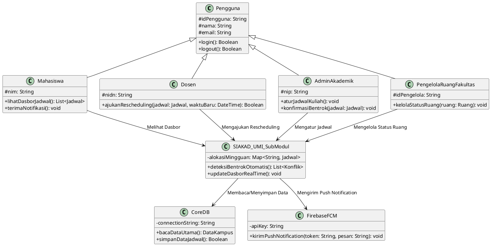

# U5 DESAIN ARSITEKTUR

## 4.1 Struktur Pandangan Arsitektur (*Architectural Views*)

Perancangan arsitektur sub-modul **Jadwal Kuliah dan Ruang** pada **Sistem Informasi Akademik (SIAKAD) Universitas Muslim Indonesia (UMI)** divisualisasikan melalui tiga pandangan utama:

### 1. Module View
Membagi elemen logis kode menjadi beberapa modul independen yang beroperasi secara terpusat:

* **Modul Penjadwalan Perkuliahan**: Mengelola draf jadwal, slot waktu, dan alokasi mata kuliah.
* **Modul Pengelolaan Ruang**: Mengelola master data ruang kelas, fasilitas fisik, serta status penggunaan ruang.
* **Modul Validasi Bentrok (*Validation Engine*)**: Mengisolasi seluruh aturan bisnis terkait pengecekan bentrok dosen, ruang, jam, mahasiswa lintas semester, serta kapasitas kelas.
* **Modul Notifikasi (*Notification Service*)**: Mengirimkan peringatan instan (*push notification*) kepada dosen dan mahasiswa apabila terdapat jadwal atau ruang yang berubah.
* **Modul Audit Logging**: Mencatat seluruh transaksi perubahan jadwal secara terpisah untuk kebutuhan penelusuran (*audit trail*).

---

### 2. Component & Connector (C&C) View
Menunjukkan interaksi antar-komponen sistem secara *runtime*:

* **API Gateway**: Bertindak sebagai *single entry point* yang menangani autentikasi JWT dan pembatasan hak akses (*Role-Based Access Control* / RBAC).
* **Validation Engine Component**: Berinteraksi secara sinkron dengan *backend* aplikasi saat pengajuan perubahan jadwal dilakukan.
* **Redis Cache**: Melayani kueri pembacaan dasbor perkuliahan secara langsung tanpa membebani basis data utama.
* **Message Broker (RabbitMQ)**: Mengelola antrean *event* secara asinkron untuk sinkronisasi data lintas modul dan pengiriman notifikasi otomatis.

---

### 3. Allocation View
Memetakan komponen perangkat lunak ke dalam infrastruktur fisik dan virtual Kampus Universitas Muslim Indonesia (UMI):

* **Web/Application Server (Node.js/Go)**: Ditempatkan pada *Virtual Private Server* (VPS) kampus yang terhubung dengan *Load Balancer*.
* **In-Memory Cache Server (Redis Cluster)**: Dialokasikan khusus pada server memori tinggi (*high memory*) untuk melayani *caching* data jadwal.
* **Database Server (MySQL Cluster)**: Ditempatkan pada server terpisah dengan konfigurasi *Master-Slave Replication* dan penyimpanan SSD berkecepatan tinggi di Data Center UMI.

---

## 4.2 Diagram Konteks (C4 System Context - Level 1)

Diagram Konteks Sistem menggambarkan batas operasional sub-modul Jadwal Kuliah dan Ruang SIAKAD UMI, aktor yang berinteraksi dengannya, serta keterhubungan dengan sistem eksternal pendukung.

