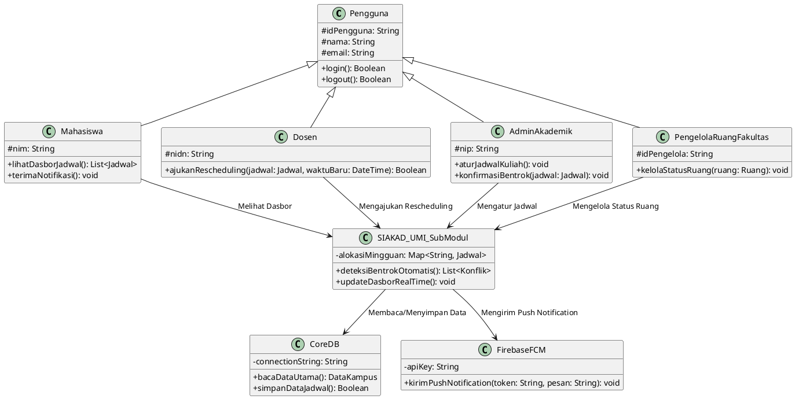

# U6. EVALUASI ARSITEKTUR

Dokumen ini memuat evaluasi menyeluruh terhadap rancangan arsitektur sub-modul **Jadwal Kuliah dan Ruang** pada **Sistem Informasi Akademik (SIAKAD) Universitas Muslim Indonesia (UMI)**. Evaluasi dilakukan melalui tiga metode utama: **Pohon Utilitas Mini**, **Matriks Evaluasi Trade-off Berbobot**, dan **Analisis ATAM (*Architecture Trade-off Analysis Method*)**, serta diakhiri dengan penjelasan **Keterbatasan Masalah Utama**.

---

## 6.1 Pohon Utilitas Mini (*Mini Utility Tree*)

Pohon Utilitas Mini digunakan untuk memetakan dan memprioritaskan kebutuhan kualitas arsitektur sistem berdasarkan tiga *Architectural Significant Requirements* (ASR) pada U1 dan U2 (yaitu **Performance Efficiency / Functional Correctness**, **Usability**, dan **Reliability**).

Setiap skenario dinilai berdasarkan dua dimensi prioritas:
- **Importance to Business (H/M/L)**: Tingkat kepentingan skenario bagi operasional akademik SIAKAD UMI (*High, Medium, Low*).
- **Difficulty to Implement (H/M/L)**: Tingkat kesulitan teknis dalam mengimplementasikan solusi arsitektur (*High, Medium, Low*).

```text
Utilitas Sub-Modul Jadwal Kuliah dan Ruang SIAKAD UMI
  ├── 1. Performance Efficiency
  │      └── Functional Correctness & Conflict Validation
  │             └── [S1] Validasi sinkron ketersediaan ruang, dosen, mahasiswa (termasuk lintas semester & lab vs teori), serta kapasitas ruang (menolak 100% bentrok, response backend <= 500 ms)
  │                    └── Prioritas: (High, High)
  │
  ├── 2. Usability
  │      └── Operability & User Responsiveness
  │             └── [S2] Akses dasbor jadwal pribadi seluler/desktop & penerimaan push notification instan perubahan jadwal (< 1,5 detik, <= 3 klik)
  │                    └── Prioritas: (High, Medium)
  │
  └── 3. Reliability
         └── Fault Tolerance, Data Persistence & Event Auditability
                └── [S3] Sinkronisasi pembaruan jadwal lintas modul (< 5 detik) & pencatatan audit log transaksi perubahan (keandalan 99,99%)
                       └── Prioritas: (High, Medium)
```

---

## 6.2 Matriks Evaluasi Trade-off Berbobot (*Weighted Trade-off Evaluation Matrix*)

Matriks ini mengukur sejauh mana keputusan arsitektur (taktik dan pola yang dipilih pada U3 & U4) mendukung pencapaian ASR serta mengidentifikasi dampak *trade-off* terhadap atribut kualitas lainnya.

| Arsitektur / Taktik Solusi | Terkait ASR | Manfaat Utama (*Benefit*) | Dampak *Trade-off* (*Cost / Risk*) | Bobot Prioritas | Skor Evaluasi (1-5) |
| :--- | :--- | :--- | :--- | :---: | :---: |
| **Synchronous Validation & Atomic Transaction Control** | ASR-01 | Menjamin 100% validasi bentrok ruang, dosen, mahasiswa lintas semester, dan kapasitas secara presisi sebelum *commit*. | Menimbulkan *overhead* waktu komputasi (*latency overhead*) dan potensi *database locking* saat transaksi masif bersamaan. | 45% | 4.8 |
| **Read-Model Caching (Redis) & Instant Push Notification** | ASR-02 | Menyajikan dasbor jadwal pribadi dalam $<1{,}5\text{ detik}$ tanpa membebani basis data utama dan memberikan notifikasi perubahan *real-time*. | Memerlukan logika pembersihan memori (*cache invalidation*) yang rumit agar tidak ada *stale data*, serta biaya integrasi push notification. | 30% | 4.6 |
| **Event-Driven Synchronization & Asynchronous Audit Logging** | ASR-03 | Memastikan integritas data status ruang sinkron dalam $<5\text{ detik}$ dan riwayat transaksi tercatat utuh tanpa mengganggu alur utama. | Adanya jeda waktu sangat kecil (*eventual consistency*) dan pertumbuhan volume basis data *audit log* seiring waktu. | 25% | 4.5 |

**Total Weighted Score**: $(0.45 \times 4.8) + (0.30 \times 4.6) + (0.25 \times 4.5) = \mathbf{4.665 \text{ / } 5.00}$

---

## 6.3 Analisis ATAM (*Architecture Trade-off Analysis Method*)

Analisis ATAM mengevaluasi keputusan arsitektur berdasarkan empat elemen kunci: **Trade-off**, **Sensitivity Points**, **Risks**, dan **Non-Risks**.

### 1. Scenario Validation: SC-01 (Akurasi Deteksi Bentrok Sinkron)
- **Sensitivity Point**: Kecepatan kueri validasi bentrok sangat sensitif terhadap kompleksitas indeks basis data dan struktur relasi antara jadwal teori, laboratorium, dosen, dan mahasiswa lintas semester.
- **Trade-off**: Mengorbankan *write latency* (kecepatan simpan) demi menjamin *data accuracy* dan konsistensi 100% bebas bentrok.
- **Risk**: Jika terjadi pengajuan perubahan jadwal secara masif oleh ratusan admin prodi pada saat yang bersamaan, *row-level locking* dapat menyebabkan antrean transaksi (*bottleneck* penulisan).
- **Non-Risk**: Penggunaan *atomic transaction rollback* menjamin tidak akan ada data setengah tersimpan yang menyebabkan jadwal bentrok lolos ke sistem.

### 2. Scenario Validation: SC-02 (Performa Dasbor & Notifikasi)
- **Sensitivity Point**: Kecepatan *response time* dasbor sangat bergantung pada efisiensi *caching* di Redis In-Memory Store.
- **Trade-off**: Mengorbankan sedikit penggunaan *RAM Server* dan penambahan infrastruktur *cache* demi mencapai *response time* dasbor $<1{,}5\text{ detik}$.
- **Risk**: Kegagalan *invalidation cache* saat admin mengubah jadwal dapat menyebabkan mahasiswa melihat jadwal lama (*stale data*) di aplikasi.
- **Non-Risk**: Penerapan API Gateway menjamin autentikasi JWT dan RBAC tetap berjalan aman tanpa membebani Redis.

### 3. Scenario Validation: SC-03 (Konsistensi Data Lintas Modul & Audit Log)
- **Sensitivity Point**: Konsistensi data status ruang di seluruh modul terpengaruh oleh *throughput* Message Broker (RabbitMQ).
- **Trade-off**: Mengorbankan konsistensi seketika (*strict immediate consistency*) menjadi *eventual consistency* ($<5\text{ detik}$) demi menjaga *throughput* sistem backend tetap tinggi.
- **Risk**: Apabila Message Broker mengalami pemadaman (*down*), pengiriman notifikasi instan dan pencatatan *audit log* dapat tertunda hingga service pulih.
- **Non-Risk**: Penyimpanan data utama di MySQL Cluster Master-Slave menjamin data jadwal yang telah *commit* tidak akan hilang (*durability*).

---

## 6.4 Keterbatasan Masalah Utama

Meskipun rancangan arsitektur sub-modul Jadwal Kuliah dan Ruang SIAKAD UMI ini telah dirancang secara optimal untuk mengatasi isu bentrok dan kinerja, terdapat beberapa keterbatasan operasional dan teknis yang perlu diperhatikan:

1. **Dependensi Kualitas Input Data Master Ruang Fisik**:
   Meski sistem memiliki *Validation Engine* yang presisi, keakuratan validasi kapasitas dan status ruang sangat bergantung pada kedisiplinan Pengelola Ruang/Fakultas dalam memperbarui master data ruang fisik (misalnya perubahan tata letak kursi atau perbaikan fasilitas fisik di lapangan).

2. **Tantangan Eventual Consistency pada Notifikasi Real-Time**:
   Penerapan arsitektur asinkron berbasis *Message Broker* menyisakan jeda waktu kecil ($<5\text{ detik}$) dalam sinkronisasi dasbor dan pengiriman push notification. Dalam kondisi koneksi jaringan pengguna akhir yang tidak stabil, mahasiswa mungkin mengalami keterlambatan penerimaan notifikasi.

3. **Pertumbuhan Ukuran Basis Data Audit Log**:
   Pencatatan *audit trail* secara mendalam untuk setiap transaksi perubahan jadwal akan meningkatkan beban kapasitas media penyimpanan (*disk storage*) pada Database Server MySQL Cluster secara signifikan seiring berjalannya semester.

---

## 6.5 Diagram Konteks System Context (PlantUML)


